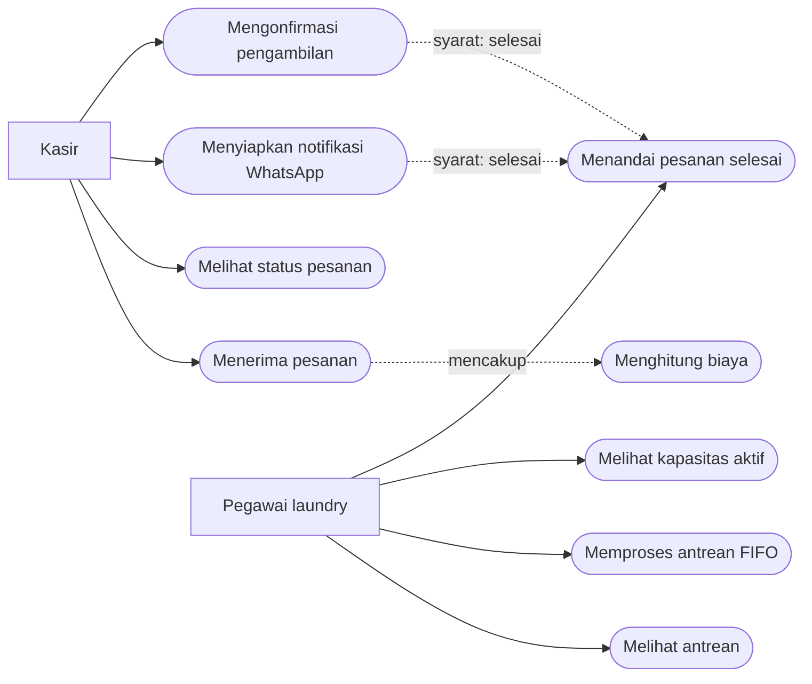
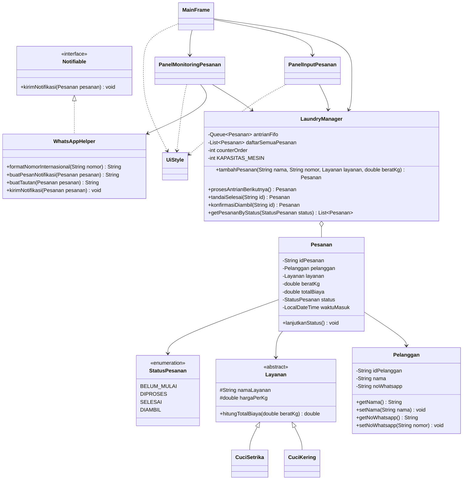
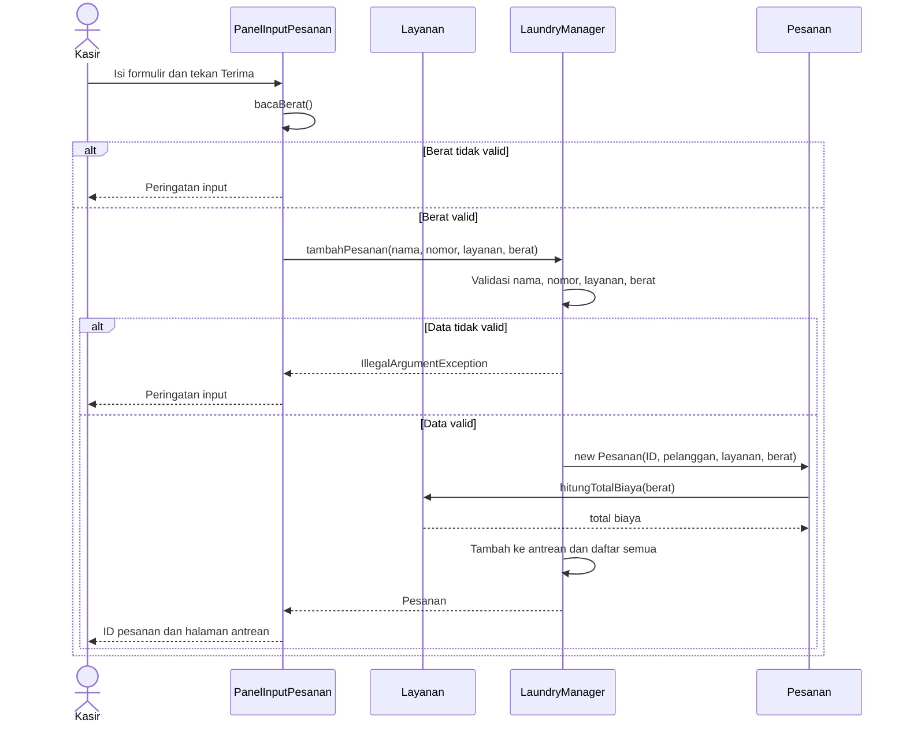
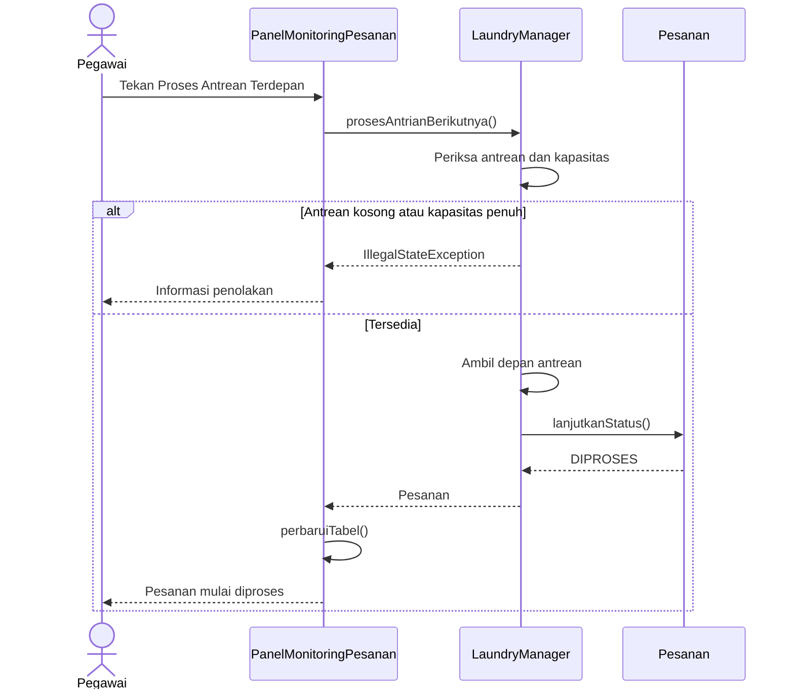

# Laporan Sistem Informasi Laundry

## BAB I — Pendahuluan

Pencatatan manual di usaha laundry dapat menyulitkan pengurutan pesanan, perhitungan biaya, dan pemantauan cucian yang siap diambil. Aplikasi ini membantu kasir dan pegawai mengelola satu siklus pesanan pada satu komputer. Tujuannya adalah menghitung biaya secara konsisten, memulai pengerjaan menurut FIFO, menjaga batas empat pesanan aktif, dan menyiapkan pemberitahuan WhatsApp.

Ruang lingkup mengikuti [PRD](../PRD.md): aplikasi desktop Java Swing, tanpa login, database, pembayaran, atau pengiriman pesan otomatis. Data hilang saat aplikasi ditutup. Angka empat merepresentasikan kapasitas kerja, bukan kendali mesin fisik.

## BAB II — Analisis sistem (OOA)

Kasir menerima pesanan, meninjau status, membuka notifikasi, dan mencatat pengambilan. Pegawai melihat antrean, memulai pengerjaan, serta menandai cucian selesai. Owner dapat melihat layar yang sama tanpa hak akses tersendiri.

### Use Case Diagram

Sumber UML formal tersedia di [USE_CASE.puml](USE_CASE.puml). Pratinjau hubungan aktor dan use case:



Use case di atas mencakup UC-01 sampai UC-08 dalam PRD, ditambah pemantauan kapasitas yang juga disebut dalam kebutuhan. Syarat status untuk notifikasi dan pengambilan diperiksa oleh program.

### Class Diagram



`Layanan` mengabstraksikan tarif. `CuciKering` dan `CuciSetrika` mengganti perhitungan melalui overriding. Panel input memakai referensi `Layanan`, sehingga pilihan layanan diproses secara polimorfik. `WhatsAppHelper` menjalankan kontrak `Notifiable`.

## BAB III — Perancangan sistem (OOD)

`MainFrame` membuat satu `LaundryManager` untuk kedua halaman yang diakses melalui navigasi samping. Saat menerima pesanan, panel memeriksa berat, lalu manager memvalidasi data lain, membuat ID, `Pelanggan`, dan `Pesanan`. Manager memasukkan pesanan ke `Queue<Pesanan>` dan `ArrayList<Pesanan>`. ID hanya bertambah setelah objek berhasil dibuat dan dicatat.

### SD-01 — Penerimaan pesanan



Estimasi sebelum penyimpanan dipanggil langsung dari objek `Layanan` saat berat atau pilihan layanan berubah. Manager menghitung ulang biaya melalui konstruktor `Pesanan` saat disimpan.

### SD-02 — Pemrosesan antrean FIFO



### SD-03 — Penyelesaian dan pengambilan

```mermaid
sequenceDiagram
    actor U as Pegawai/Kasir
    participant UI as PanelMonitoringPesanan
    participant M as LaundryManager
    participant O as Pesanan
    participant W as WhatsAppHelper
    U->>UI: Pilih pesanan diproses dan Tandai Selesai
    UI->>M: tandaiSelesai(id)
    alt Belum berstatus DIPROSES
        M-->>UI: Penolakan perubahan status
    else Valid
        M->>O: lanjutkanStatus()
        O-->>M: SELESAI
        M-->>UI: Pesanan
        UI->>UI: perbaruiTabel()
        U->>UI: Pilih pesanan siap diambil dan buka WhatsApp
        UI->>W: kirimNotifikasi(pesanan)
        W->>W: Normalisasi nomor, siapkan pesan dan tautan
        alt Browser tidak tersedia/gagal
            W-->>UI: Exception
            UI-->>U: Tampilkan tautan dan pesan untuk disalin
        else Browser tersedia
            W-->>U: Browser terbuka; kasir mengirim manual
        end
        U->>UI: Konfirmasi Sudah Diambil
        UI->>M: konfirmasiDiambil(id)
        M->>O: lanjutkanStatus()
        O-->>M: DIAMBIL
        UI->>UI: perbaruiTabel()
    end
```

Penyelesaian memakai ID dari baris yang dipilih, sehingga tidak mengikuti FIFO. Hanya pemrosesan awal yang mengambil kepala antrean.

## BAB IV — Implementasi dan pengujian

Kode memakai Java 17 dan pustaka standar. Struktur: `model` menyimpan objek dan status; `service` berisi aturan operasional; `util` menyiapkan format dan WhatsApp; `ui` menampilkan formulir dan tiga tabel. Terdapat 15 file Java di `src`: `FormatUtil` memusatkan format Rupiah dan berat, sedangkan `UiStyle` memusatkan gaya antarmuka. `Main.java` memulai GUI di Swing Event Dispatch Thread. Cara menjalankan tersedia di [README](../README.md).

Konsep OOP terlihat pada atribut privat dan getter/setter (`Pelanggan`), inheritance dan abstract method (`Layanan`), overriding dan polymorphism (dua paket), serta interface (`Notifiable`). Status maju satu tahap melalui `Pesanan.lanjutkanStatus()`. Manager membatasi kapan method itu dipanggil untuk alur operasional. Tiga tabel mengambil data dari manager dan tidak dapat diedit langsung.

Pengujian otomatis di `test/com/laundry/LaundryManagerTest.java` mencakup tarif, pembulatan, input tidak valid, ID setelah kegagalan, FIFO, batas empat pesanan, penyelesaian di luar urutan, transisi status, normalisasi nomor, isi tautan WhatsApp, dan 100 pesanan dalam satu sesi. Jalankan perintah pengujian di README. Pemeriksaan yang membutuhkan interaksi manusia: buka GUI, ubah berat dan layanan untuk melihat estimasi, pilih baris pada masing-masing tabel, dan coba tombol WhatsApp pada komputer dengan browser.

| Skenario PRD | Bukti pemeriksaan |
|---|---|
| TC-01, TC-04, TC-06–TC-10 | Uji otomatis membuat pesanan valid, menolak data salah, memeriksa tarif, ID, dan urutan FIFO. |
| TC-11–TC-13, TC-17–TC-18 | Uji otomatis memeriksa antrean kosong, kapasitas, penyelesaian bebas, pengambilan, dan penolakan status. |
| TC-15 | Uji otomatis memeriksa nomor, URL, dan isi pesan. |
| TC-02, TC-03, TC-05, TC-14, TC-16, TC-19 | Validasi dan dialog ada di GUI; verifikasi visual/interaktif tetap diperlukan. |
| TC-20 | Data hanya berada dalam memori; restart membuat manager baru. |

## BAB V — Penutup

Aplikasi memenuhi alur operasional dasar laundry untuk satu komputer. Pengembangan berikutnya dapat menambahkan penyimpanan permanen dan laporan transaksi jika lingkup proyek diperluas. Seluruh anggota kelompok sebaiknya dapat menjelaskan hubungan diagram dengan class, alur FIFO, pembatasan kapasitas, dan alasan notifikasi tetap dikirim manual oleh kasir.
